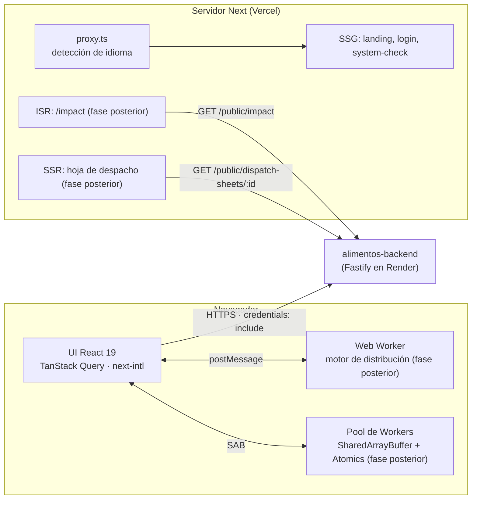
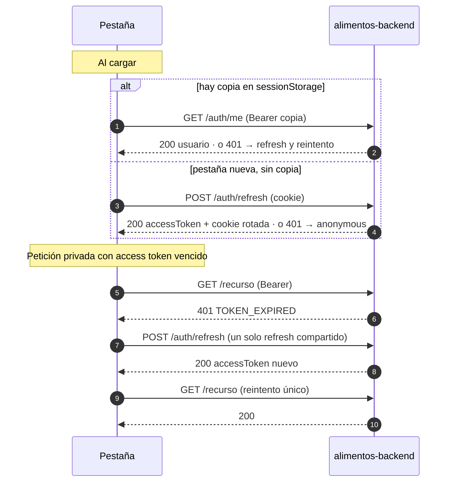

# alimentos-frontend

Aplicación web de **AlimentaIQ — Centro Inteligente de Distribución de Alimentos**. Es la interfaz
para administradores y operadores: inventario por lotes, pedidos, propuestas de distribución,
alertas y reportes. Solo habla con `alimentos-backend`; no tiene código compartido con los otros
repos.

- Stack: Next.js 16 (App Router) · React 19 · TypeScript estricto · Tailwind CSS v4 ·
  TanStack Query · next-intl · next-themes.
- Despliegue: Vercel.
- Estado: diseño base, i18n (es/en), tema claro/oscuro, aislamiento de origen cruzado y
  autenticación real (login, sesión entre pestañas y área privada con tablero provisional). Las
  pantallas de negocio llegan en fases posteriores.

## Arquitectura



## Rendering por ruta

| Ruta                                       | Patrón    | Estado         | Notas                                                                    |
| ------------------------------------------ | --------- | -------------- | ------------------------------------------------------------------------ |
| `/[locale]` (landing)                      | SSG       | Hecho          | `generateStaticParams` para `es` y `en`                                  |
| `/[locale]/login`                          | SSG + CSR | Hecho          | Shell estático; el formulario y la sesión corren en el navegador         |
| `/[locale]/system-check`                   | SSG + CSR | Hecho          | Shell estático; los valores se leen en el navegador                      |
| `/[locale]/impact`                         | ISR       | Hecho          | `revalidate 3600` para `es` y `en`, consume `GET /public/impact`         |
| Hoja de despacho                           | SSR       | Fase posterior | Enlace firmado [EXTRA]                                                   |
| `/[locale]/app` (panel)                    | CSR       | Hecho          | KPIs de `/inventory/summary`; HTML estático = skeleton                   |
| `/[locale]/app/products`                   | CSR       | Hecho          | Filtros en la URL; tabla en escritorio, tarjetas en móvil                |
| `/[locale]/app/products/[id]`              | CSR       | Hecho          | Métricas, razones traducidas, lotes FEFO; acciones ADMIN                 |
| `/[locale]/app/movements`                  | CSR       | Hecho          | Solo ADMIN (guard de UX; la API responde 403 igual)                      |
| `/[locale]/app/orders` (+ `/new`, `/[id]`) | CSR       | Hecho          | Filtros en la URL; crear solo ADMIN; botones según la máquina de estados |
| `/[locale]/app/missions`                   | CSR       | Hecho          | Pantalla principal del OPERATOR en móvil                                 |
| `/[locale]/app/alerts`                     | CSR       | Hecho          | Agrupadas por severidad; refresco cada 60 s                              |
| `/[locale]/app/customers`                  | CSR       | Hecho          | Solo ADMIN                                                               |
| `/[locale]/app/distribution` (+ `/[id]`)   | CSR       | Hecho          | Simulador en Web Worker, comparar, generar, confirmar; ADMIN y OPERATOR  |
| `/[locale]/app/lab/performance`            | CSR       | Hecho          | Solo ADMIN: hilo principal vs Web Worker con datos sintéticos            |
| `/[locale]/app/metrics`                    | CSR       | Hecho          | Solo ADMIN: API, servidor, Web Vitals, navegador y benchmark             |
| `/[locale]/app/reports`                    | CSR       | Hecho          | Solo ADMIN: CSV/PDF de inventario, pedidos y mermas                      |

## Autenticación

El backend emite un **access token** JWT de corta duración (15 min) en el body y un **refresh
token** opaco en una cookie `HttpOnly; Secure; SameSite=None; Path=/api/v1/auth` del dominio del
API. El frontend nunca lee la cookie: solo la envía con `credentials: "include"`.

| Dato                    | Dónde vive                                                        | Por qué                                                           |
| ----------------------- | ----------------------------------------------------------------- | ----------------------------------------------------------------- |
| Access token            | Memoria de la pestaña + copia en `sessionStorage` (`aiq.session`) | La copia evita un refresh al recargar; muere al cerrar la pestaña |
| Refresh token           | Cookie `HttpOnly` del API                                         | Inaccesible desde JS, así que un XSS no puede robarla             |
| Usuario (`id`, nombre…) | Memoria (store de sesión)                                         | Se vuelve a pedir con `GET /auth/me` en cada carga                |
| Nada                    | `localStorage`, cookies escritas desde JS, logs                   | Prohibido: persisten entre sesiones o quedan expuestos            |

Estados de la sesión: `loading` → `authenticated` | `anonymous`.



- `authFetch` (en `src/features/auth/auth-client.ts`) agrega `Authorization: Bearer` y, ante un
  401 `TOKEN_EXPIRED` o `UNAUTHENTICATED`, hace **un** refresh y reintenta **una** vez. Si el
  refresh responde 401 la sesión pasa a `anonymous` y se borra la copia; un error de red no
  cierra la sesión.
- **Single flight**: si varias peticiones reciben 401 a la vez, comparten la misma promesa de
  refresh (una sola llamada).
- Al cerrar sesión se borra la caché de TanStack Query para que el siguiente usuario no vea datos
  del anterior.

### Varias pestañas

El backend **rota** el refresh token en cada uso y, si recibe uno ya rotado, lo trata como robo y
revoca toda la familia (todas las pestañas quedan fuera). Como la cookie es compartida por todas
las pestañas, dos refresh simultáneos llevarían la misma cookie y dispararían esa detección. Por
eso:

1. **Dentro de la pestaña**: una sola promesa de refresh compartida (single flight).
2. **Entre pestañas**: el refresh corre dentro de `navigator.locks.request("aiq-refresh")`. La
   pestaña que renueva publica el token nuevo en el `BroadcastChannel` `"aiq-auth"`; la que
   esperaba el lock ve que su token ya cambió y lo reutiliza sin llamar a refresh. Si el aviso
   llegara tarde, la segunda pestaña refresca con la cookie ya rotada: una rotación de más, nunca
   un reuso.
3. **Login y logout se difunden**: iniciar sesión en una pestaña autentica a las demás; cerrar
   sesión la cierra en todas y borra sus copias.
4. Una pestaña nueva (sin copia en `sessionStorage`) recupera la sesión con la cookie.

Una prueba (`tests/auth-cross-tab.test.ts`) demuestra que sin el lock la carrera sí revoca la
sesión. En la fase 5 esto pasa a un `SharedWorker` que será dueño de la sesión de todas las
pestañas.

### Login

- Validación en el cliente (correo y contraseña obligatorios, formato y longitudes del backend) y
  errores traducidos por código: 401 credenciales incorrectas, 400 datos inválidos, error de red
  y error inesperado. Nunca se muestra el `message` del servidor.
- **429**: cuenta regresiva `m:ss` a partir del header `Retry-After` (expuesto por CORS); el botón
  queda deshabilitado hasta que termina.
- `?next=`: solo se acepta una ruta interna del área privada (`/es/app`, `/en/app/...`). Se
  rechazan `//host`, URLs absolutas, `\`, caracteres de control y rutas que al normalizarse salen
  del área privada (`/es/app/../login`), para evitar un _open redirect_.

### Dónde está la seguridad de verdad

- **La protección real está en el API**: cada endpoint privado valida el Bearer y el rol en el
  servidor (`401`/`403`). El guard del cliente (`RequireAuth`) y `<RequireRole roles={[...]}>`
  son **UX**: evitan mostrar pantallas que de todos modos fallarían, pero quitar el guard desde
  las DevTools no da acceso a ningún dato.
- **No hay SSR autenticado**: la cookie de refresh pertenece a `*.onrender.com` (con
  `Path=/api/v1/auth`), así que el navegador nunca la envía al servidor de Next en `*.vercel.app`,
  y el access token solo existe en memoria del navegador. El servidor de Next no puede saber quién
  es el usuario; por eso el área privada es CSR: su HTML estático es un skeleton y la sesión se
  resuelve en el navegador.

### Estructura

| Archivo                               | Responsabilidad                                                    |
| ------------------------------------- | ------------------------------------------------------------------ |
| `src/features/auth/api.ts`            | Llamadas a `/auth/login`, `/auth/refresh`, `/auth/logout`          |
| `src/features/auth/session-store.ts`  | Estado de la sesión en memoria + copia en `sessionStorage`         |
| `src/features/auth/auth-client.ts`    | `authFetch`, refresh coordinado, bootstrap, login y logout         |
| `src/features/auth/auth-channel.ts`   | `BroadcastChannel` `aiq-auth` con mensajes validados               |
| `src/features/auth/refresh-lock.ts`   | Lock `aiq-refresh` con la Web Locks API                            |
| `src/features/auth/auth-provider.tsx` | Provider de React; arranca la sesión después del montaje           |
| `src/features/auth/use-auth.ts`       | Hook `useAuth()` (estado, usuario, `login`, `logout`, `authFetch`) |
| `src/features/auth/guards.tsx`        | `RequireAuth` y `RequireRole`                                      |
| `src/features/auth/safe-next.ts`      | Validación de `?next=`                                             |
| `src/features/auth/login-*.ts`        | Validación del formulario y mapeo de errores a claves i18n         |

## Internacionalización

- Idiomas: `es` (por defecto) y `en`, siempre con prefijo (`/es/...`, `/en/...`).
- Todos los textos viven en `messages/es.json` y `messages/en.json`; no hay texto quemado en
  los componentes. Las claves están tipadas: una clave inexistente falla en `typecheck`, y una
  prueba verifica que ambos archivos tengan exactamente las mismas claves y ningún valor vacío.
- Next 16 renombró `middleware.ts` a **`proxy.ts`**; next-intl se conecta ahí con
  `createMiddleware(routing)` (`src/proxy.ts`).

## Tema

Claro por defecto. El usuario puede cambiar a oscuro con el botón del header y la preferencia
se guarda; la preferencia del sistema operativo se ignora a propósito (`enableSystem: false`).

## Inventario y productos

- **App shell**: sidebar verde bosque en escritorio y barra inferior en móvil (mobile-first: el
  OPERATOR la usa en bodega). Las entradas dependen del rol (`features/app-shell/navigation.ts`);
  Movimientos es solo ADMIN y los módulos futuros aparecen deshabilitados como "Próximamente".
- **Barra de frescura**: diez celdas por lote que se apagan a medida que se acerca el vencimiento
  (verde → ámbar a ≤ 7 días → rojo a ≤ 2 días; vencido = gris rayado). El texto con los días
  siempre está visible, así que no depende solo del color. La lógica es pura y está probada
  (`features/inventory/freshness.ts`).
- **Razones**: el servidor manda `reasons[{ code, params }]` y la UI las traduce con next-intl
  (`Reasons.*`). Un código desconocido muestra un mensaje genérico, nunca texto del servidor.
- **Filtros en la URL**: `/app/products?search=&category=&stockStatus=&expiringWithinDays=` se
  pueden recargar y compartir. Los valores inválidos se descartan antes de llamar a la API. El KPI
  de riesgo de merma usa `wasteRisk=HIGH`, que se filtra en el navegador porque la API no tiene
  ese filtro.
- **Escrituras (ADMIN)**: crear y editar producto, entrada y salida en modales sobre `<dialog>`.
  En un 409 `INSUFFICIENT_STOCK` el formulario muestra lo disponible (de `details`) y ofrece
  "Usar X". Cada escritura invalida las queries afectadas (`features/inventory/query-keys.ts`).
- **Fechas**: las de calendario (`expiryDate`) se formatean en UTC para no correrse un día, y las
  fechas con hora en `America/Bogota` (`timeZone` de next-intl).
- **Movimiento**: conteo de KPIs, barras que se llenan y botones que se hunden al presionar; con
  `prefers-reduced-motion` todo queda estático.

## Pedidos, misiones, alertas y clientes

- **Máquina de estados espejo** (`features/orders/state-machine.ts`): la misma tabla del backend,
  pura y probada por rol. Solo decide qué botones mostrar; el servidor valida cada cambio. Un 409 se
  traduce por `details.reason` (`REQUIRES_PROPOSAL` → "se prepara desde Distribución").
- **Cuenta regresiva** en días de calendario de Bogotá: a las 23:59 en Bogotá un pedido que vence
  "hoy" sigue venciendo hoy aunque en UTC ya sea mañana.
- **Prioridad con color e ícono**: URGENT rojo con un pulso suave, HIGH naranja, MEDIUM lagoon y LOW
  gris; el texto siempre acompaña al color.
- **Misiones de hoy**: los pedidos en preparación, listos y enviados como tarjetas con barra de
  progreso y un botón grande para avanzar. Al entregar sale un confeti ligero y sube el contador
  "misiones completadas hoy" (guardado por usuario y día en este navegador). En móvil es la
  pantalla de inicio del OPERATOR.
- **Alertas**: se traducen por código y parámetros; el conteo de CRITICAL aparece como insignia en
  la navegación (consulta compartida, refresco cada 60 s; en la fase 5 pasa a un SharedWorker).
- **Foto de perfil**: desde el menú de usuario. Se recorta a un cuadrado de 160 px y se guarda en
  `localStorage` de este navegador (no es un secreto). Subirla al backend queda para una fase
  posterior.
- **Botones 3D**: cada botón tiene un "borde" inferior sólido en el que se hunde al presionar y se
  eleva un píxel al pasar el mouse. Con `prefers-reduced-motion` solo cambia el color.

## Distribución y motor en Web Worker

- **Motor copiado, no compartido**: `src/features/distribution/engine/` es una copia del motor puro
  de `alimentos-backend` (`MinHeap`, `scoreOrder`, estrategias `BALANCED`, `URGENCY_FIRST`,
  `WASTE_FIRST`, `buildProposal`, `allocateFefo`). Diferencias: no tiene el desempate por IA (eso
  lo hace el servidor en `AI_ASSISTED`) y acepta un `onProgress` que no cambia el resultado.
- **Paridad**: `tests/fixtures/distribution-parity/` son copias exactas de los 3 fixtures del
  backend, tomados del commit **`f716926`** de `alimentos-backend`. `tests/distribution-parity.test.ts`
  exige el mismo `ranking`, `lines` y `summary` (salvo `processingMs`). Si el algoritmo cambia en
  el backend, se copian de nuevo los fixtures y el código, y se actualiza este commit.
- **Web Worker**: `src/workers/distribution.worker.ts`, creado en `create-worker.ts` con
  `new Worker(new URL('…', import.meta.url), { type: 'module' })`. Según la documentación de
  Next 16 incluida en `node_modules/next/dist/docs` (Turbopack: magic comments en `new Worker()`
  y `turbopackWorkerAssetPrefix` para "Web Worker URLs (entrypoint + module chunks)"), Turbopack
  empaqueta el worker como entrada propia: en el build aparece `static/chunks/turbopack-worker-*.js`,
  que carga los chunks del motor. Se sirve desde el mismo origen con COOP/COEP, así que funciona
  con `require-corp` (verificado: `crossOriginIsolated` es `true`).
- **Protocolo tipado** (`worker-protocol.ts`): `run` → `progress` (cada N pedidos) → `result` |
  `error`; `cancel` descarta un `run` que sigue en cola. `EngineClient` usa `requestId` y canales:
  en cada canal solo cuenta el último `run` y los resultados viejos se descartan. Un cálculo en
  curso no se puede interrumpir (es síncrono), así que cancelar termina el worker y se crea otro.
  `useEngineWorker()` lo termina al desmontar.
- **Pantalla `/app/distribution`**: simulador con pesos que siempre suman 100 (con debounce, en el
  Worker, sobre `GET /distribution/snapshot`, ranking con animación FLIP que respeta
  `prefers-reduced-motion`), comparación del top 10 de las 3 estrategias, generación de la
  propuesta oficial (`{ strategy, weights?, locale }`; el servidor recalcula), detalle con KPIs,
  líneas por pedido, frescura del lote y razones traducidas, confirmar (diálogo) y descartar. Los
  409 `STALE_PROPOSAL` (`STOCK_CHANGED`, `ORDER_CHANGED`, `NOT_DRAFT`, `BUSINESS_DATE_CHANGED`) se
  traducen y ofrecen "Generar de nuevo". Si `AI_ASSISTED` vuelve con `degraded: true` se muestra
  un aviso amable. La tarjeta "Explicación de la IA" nunca rompe la pantalla: con 404, 503 o sin
  red dice "IA no disponible por ahora". El texto de la IA es plano; el formato (códigos de
  pedido como enlaces) lo pone el frontend.

## Laboratorio: hilo principal vs Web Worker

`/app/lab/performance` (solo ADMIN) genera un snapshot sintético **determinista** (semilla,
1.000 a 20.000 pedidos) y ejecuta el mismo motor en el hilo principal o en el Worker. Mide la
duración total, el frame más largo (huecos entre callbacks de `requestAnimationFrame`, tomados
con `performance.now()`), las long tasks (`PerformanceObserver` `longtask`) y un INP aproximado
del botón "Haz clic mientras calcula" (`PerformanceObserver` `event` con `durationThreshold` 16;
si el navegador no reporta eventos, como Chrome headless, se usa la espera del clic medida en su
manejador). El indicador se mueve con JavaScript en cada frame, **no con CSS**: las animaciones
CSS de `transform` corren en el compositor y no se congelan, así que no demostrarían nada. Los
resultados se exportan en JSON.

Medición local (Chrome 155 headless, build de producción, 10.000 pedidos, semilla 20261028):

| Modo           | Duración total | Motor  | Frame más largo | Long tasks | INP aprox. |
| -------------- | -------------- | ------ | --------------- | ---------- | ---------- |
| Hilo principal | 216 ms         | 216 ms | 218 ms          | 1 (216 ms) | 121 ms     |
| Worker         | 363 ms         | 279 ms | 15 ms           | 0          | 2 ms       |
| Hilo principal | 142 ms         | 142 ms | 144 ms          | 1 (141 ms) | 26 ms      |
| Worker         | 426 ms         | 386 ms | 22 ms           | 0          | 1 ms       |

Con 20.000 pedidos: hilo principal 606 ms congelado (frame de 608 ms, INP 490 ms); Worker 1.716 ms
en total con el frame más largo en 65 ms. El Worker tarda más en total (copia del snapshot y CPU
compartida) pero la página nunca se congela.

## Alertas compartidas entre pestañas (SharedWorker)

- `src/workers/alerts.shared-worker.ts` hace **un solo** `GET /alerts` cada 60 s para todas las
  pestañas y difunde `{ counts por severidad, alerts, fetchedAt }` a todos los puertos. La lógica
  vive en `features/alerts/alerts-hub.ts` y se prueba sin el worker.
- Cada pestaña le envía el access token por su `MessagePort` al conectarse, al iniciar sesión y en
  cada refresh (`null` al cerrar sesión: el worker deja de sondear y limpia los datos). Ante un 401
  el worker pide a **una** pestaña que refresque; la pestaña usa el refresh de siempre (single
  flight + Web Lock `aiq-refresh`), así el worker nunca llama a `/auth/refresh`. El token solo
  vive en memoria y nunca se registra.
- Latido cada 15 s: los puertos de pestañas que murieron sin despedirse se quitan; `pagehide` envía
  `bye`.
- Si el navegador no tiene `SharedWorker` (Chrome en Android, por ejemplo), `useSharedAlerts()` usa
  el sondeo por pestaña con TanStack Query de antes: la interfaz es la misma.

## Service Worker y página offline

- `public/sw.js` se registra solo en producción como `/sw.js?v=<versión del build>` (el commit en
  Vercel). La versión nombra las cachés; al activarse una versión nueva se borran las viejas y la
  app muestra "Nueva versión disponible · Recargar".
- Precarga `/es/offline` y `/en/offline` (con sus archivos `_next/static`) y el ícono.
  `_next/static`: cache-first. Navegaciones: network-first, luego la copia en caché y, sin red, la
  página offline del idioma de la URL.
- **Nunca** cachea `/api`, otros orígenes (el backend), peticiones con `Authorization`, métodos que
  no sean GET ni el login.
- Las respuestas guardadas conservan sus headers, incluidos COOP/COEP: una página servida desde la
  caché sigue con `crossOriginIsolated = true` (verificado). `sw.js` recibe los headers de
  `next.config` y `Cache-Control: no-cache`.

## Pool paralelo con SharedArrayBuffer + Atomics (laboratorio)

- `min(hardwareConcurrency - 1, 4)` workers (`src/workers/score-pool.worker.ts`) puntúan partes del
  snapshot en paralelo y escriben en un `Float64Array` compartido. La asignación FEFO es secuencial:
  la hace después el worker 0 con el heap, partiendo de esos puntajes (`initialScores`).
- Control en un `Int32Array` compartido: progreso (`Atomics.add`), bandera de cancelación
  (`Atomics.store` / `Atomics.load` por pedido) y workers terminados (`Atomics.add` +
  `Atomics.notify`). El hilo principal **no** usa `Atomics.wait`: espera con `Atomics.waitAsync` o
  revisando en cada frame. El anillo de progreso lee `Atomics.load` en cada frame, sin un
  `postMessage` por avance: la primera mitad del anillo es el puntaje en paralelo y la segunda la
  asignación. Cancelar funciona en las dos fases (la asignación revisa la bandera cada 100 pedidos).
- Los workers del pool arrancan al abrir el laboratorio, así la primera corrida no mide su arranque.
- El resultado es idéntico al del motor de un solo worker (pruebas con los fixtures de paridad).
- Sin aislamiento de origen cruzado no hay `SharedArrayBuffer`: el modo queda deshabilitado y se
  explica por qué.

### Resultados medidos (build de producción local, Chrome, 12 núcleos, semilla 20261028)

| #   | Modo                              | Workers | Pedidos | Duración total |  Motor | Frame más largo | Long tasks |
| --- | --------------------------------- | ------: | ------: | -------------: | -----: | --------------: | ---------: |
| 1   | Hilo principal                    |       0 |  10.000 |         540 ms | 537 ms |          550 ms | 1 (540 ms) |
| 2   | Worker                            |       1 |  10.000 |         936 ms | 802 ms |           38 ms |          0 |
| 3   | Pool paralelo                     |       4 |  10.000 |         710 ms | 706 ms |           71 ms |  1 (66 ms) |
| 4   | Hilo principal                    |       0 |  20.000 |         368 ms | 368 ms |          374 ms | 1 (368 ms) |
| 5   | Worker                            |       1 |  20.000 |         505 ms | 445 ms |           43 ms |          0 |
| 6   | Pool paralelo                     |       4 |  20.000 |         531 ms | 530 ms |          128 ms | 1 (125 ms) |
| 7   | Pool paralelo (cancelado al 50 %) |       4 |  20.000 |         218 ms |      — |          121 ms | 1 (118 ms) |

Lectura honesta: el pool **no** es mucho más rápido que un worker. Solo el puntaje inicial se
reparte; el heap con re-puntaje perezoso y la asignación FEFO son secuenciales (ley de Amdahl), y
copiar el snapshot a 4 workers con `postMessage` cuesta una tarea larga corta en el hilo principal
(66–125 ms, frente a 368–540 ms congelado en el hilo principal). Los tiempos varían entre corridas
por el JIT (la primera corrida de cada motor es la más lenta). Lo que sí muestra el pool es memoria
compartida real: progreso y cancelación sin mensajes.

## Métricas, Web Vitals y reportes

- **Web Vitals** (`web-vitals` 6.2.3): INP, LCP, CLS, TTFB y FCP van a `POST /metrics/web-vitals`
  con `fetch` `keepalive` y Bearer (vía `authFetch`), **solo con sesión**. TTFB y FCP llegan antes
  de que la sesión se restaure: esperan en memoria y se envían si termina autenticada (se
  descartan si termina anónima). La `page` es el patrón de la ruta sin idioma
  (`/es/app/orders/4f1c…` → `/app/orders/[id]`); una URL desconocida se envía como `/[...rest]`,
  nunca como se escribió. Una prueba mantiene la lista de patrones igual a `src/app/[locale]`.
- **`/app/metrics`** (ADMIN): rutas de la API ordenadas por p95 (p50/p95/p99, peticiones, 5xx);
  memoria (RSS, heap), lag del event loop y uptime del backend; p75 de Web Vitals por métrica y por
  página con los umbrales de Google (INP 200/500, LCP 2500/4000, CLS 0,1/0,25, TTFB 800/1800, FCP
  1800/3000), siempre con color **y** texto; Navigation Timing de esta carga; memoria con
  `performance.measureUserAgentSpecificMemory()` (solo existe con aislamiento de origen cruzado,
  muestra un spinner porque espera una recolección de basura), si no `performance.memory`, si no
  "no disponible". El benchmark de Worker Threads respeta el máximo del backend (30.000, o el que
  diga un 400), traduce el 409 `BENCHMARK_RUNNING` y dibuja barras en SVG hecho a mano.
- **`/app/reports`** (ADMIN): una tarjeta por reporte con formato, idioma y rango (inventario es la
  foto de hoy). La descarga usa `authRequest` (como `authFetch` pero devuelve la `Response`) → blob
  → `<a download>` con el nombre de `Content-Disposition` (el backend lo expone por CORS). Muestra
  `X-Generation-Time-Ms`, el tamaño y el tiempo total medido en el navegador, y el historial de la
  sesión.
- **`/[locale]/impact`** (pública, ISR): `export const revalidate = 3600` y
  `generateStaticParams` para `es` y `en`. Pide `{API_URL_INTERNAL ?? NEXT_PUBLIC_API_URL}/api/v1/public/impact`
  con un timeout de 8 s; si el backend no responde (también durante `next build`) la página se
  genera con "Datos no disponibles" y el build no falla. Contadores animados (respetan
  `prefers-reduced-motion`), hora de Bogotá y la nota de ISR. Enlazada desde el header y el
  footer.
- Verificado en el build local: `/es/impact` y `/en/impact` salen con `initialRevalidateSeconds:
3600` en `.next/prerender-manifest.json` y responden `x-nextjs-cache: HIT` con
  `Cache-Control: s-maxage=3600`. Next 16.4 no imprime la columna "Revalidate" en la tabla del
  build cuando la ruta ISR es hija de `generateStaticParams` (solo mira la ruta padre
  `/[locale]/impact`), aunque el valor se aplica.

## Por qué COOP y COEP

`next.config.ts` envía en todas las rutas:

| Header                         | Valor                             |
| ------------------------------ | --------------------------------- |
| `Cross-Origin-Opener-Policy`   | `same-origin`                     |
| `Cross-Origin-Embedder-Policy` | `require-corp`                    |
| `Referrer-Policy`              | `strict-origin-when-cross-origin` |
| `X-Content-Type-Options`       | `nosniff`                         |

COOP + COEP activan `window.crossOriginIsolated`, requisito del navegador para usar
`SharedArrayBuffer` y `Atomics` en el pool de workers del motor de distribución. Se activan
desde el día 1 para detectar temprano cualquier recurso incompatible. Consecuencias:

- Las fuentes se sirven desde el propio dominio con `next/font`.
- El backend responde con `Cross-Origin-Resource-Policy: cross-origin` y CORS con allowlist.
- Las imágenes externas (Cloudinary) deberán cargarse con `crossOrigin="anonymous"`.

La página `/es/system-check` muestra `crossOriginIsolated`, `typeof SharedArrayBuffer`,
`hardwareConcurrency` y el estado y tiempo de respuesta de `GET /api/v1/health/ready`.

## Variables de entorno

Plantilla en [.env.example](.env.example). Nunca se commitean valores reales.

| Variable              | Obligatoria | Uso                                                                                 |
| --------------------- | ----------- | ----------------------------------------------------------------------------------- |
| `NEXT_PUBLIC_API_URL` | Sí          | Origen del backend, sin barra final y sin `/api/v1`                                 |
| `API_URL_INTERNAL`    | No          | Solo servidor: origen del backend para el ISR de `/impact` (si hay una red interna) |

El cliente agrega `/api/v1` y envía `credentials: "include"`. El backend debe incluir el origen
del frontend en su `CORS_ORIGINS`.

## Puesta en marcha local

```bash
npm ci
cp .env.example .env   # NEXT_PUBLIC_API_URL=http://localhost:4000 para el backend local
npm run dev            # http://localhost:3000
```

Para probar el login en local, el backend debe correr en el puerto 4000 con
`CORS_ORIGINS=http://localhost:3000` y los usuarios demo creados con su seed (`npx prisma db seed`
en `alimentos-backend`). `localhost` cuenta como contexto seguro, así que la cookie `Secure` del
refresh funciona sin HTTPS. Una variable `NEXT_PUBLIC_API_URL` definida en la terminal tiene
prioridad sobre el `.env`:

```bash
NEXT_PUBLIC_API_URL=http://localhost:4000 npm run dev
```

## Scripts

| Script                 | Descripción                       |
| ---------------------- | --------------------------------- |
| `npm run dev`          | Servidor de desarrollo en el 3000 |
| `npm run build`        | Build de producción               |
| `npm start`            | Sirve el build en el 3000         |
| `npm test`             | Pruebas con Vitest                |
| `npm run lint`         | ESLint (config de Next 16)        |
| `npm run typecheck`    | `tsc --noEmit`                    |
| `npm run format`       | Formatea con Prettier             |
| `npm run format:check` | Verifica el formato (lo usa CI)   |

## Puertos

| Servicio             | Puerto local |
| -------------------- | ------------ |
| `alimentos-frontend` | 3000         |
| `alimentos-backend`  | 4000         |
| `alimentos-ai`       | 4100         |

## Despliegue en Vercel

- Framework: Next.js (detectado automáticamente). Install: `npm ci` · Build: `npm run build`.
- Node: 22 (`engines` en `package.json`).
- Variable: `NEXT_PUBLIC_API_URL` con el origen del backend en Render (sin barra final). Al ser
  pública se incrusta en el bundle durante el build: si cambia, hay que volver a desplegar.
- En el backend, `CORS_ORIGINS` debe incluir el dominio `*.vercel.app` del frontend.
- Frontend (`*.vercel.app`) y API (`*.onrender.com`) son sitios distintos: la cookie de refresh
  es `HttpOnly; Secure; SameSite=None` en el dominio del API y el access token viaja en
  `Authorization: Bearer`. Los navegadores que bloquean cookies de terceros (Safari, o Chrome con
  esa opción) no envían la cookie: el login funciona, pero la sesión no sobrevive a una pestaña
  nueva ni al vencimiento del access token. Un dominio propio común (`app.` y `api.`) lo resuelve.

## CI

GitHub Actions en cada push y PR a `main`: `npm ci`, lint, formato, typecheck, pruebas y build,
con `NEXT_PUBLIC_API_URL=https://example.com` definido en el workflow.
