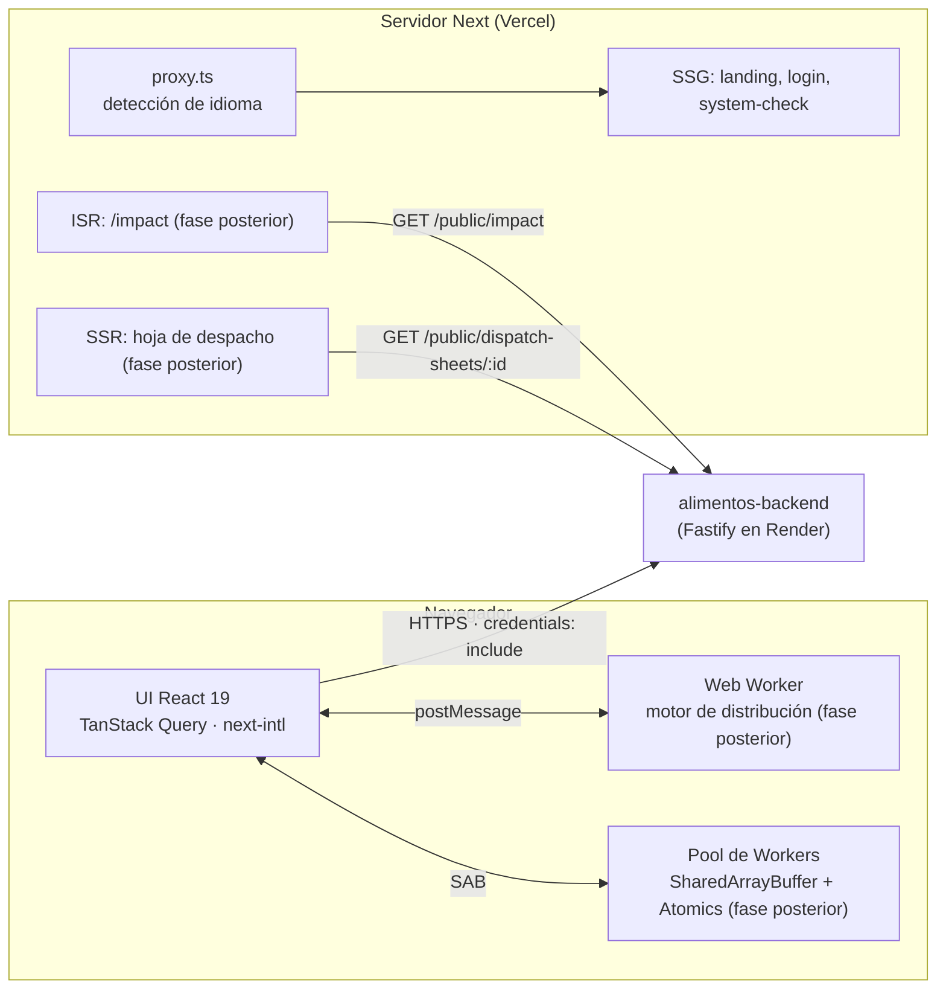

# alimentos-frontend

Aplicación web de **AlimentaIQ — Centro Inteligente de Distribución de Alimentos**. Es la interfaz
para administradores y operadores: inventario por lotes, pedidos, propuestas de distribución,
alertas y reportes. Solo habla con `alimentos-backend`; no tiene código compartido con los otros
repos.

- Stack: Next.js 16 (App Router) · React 19 · TypeScript estricto · Tailwind CSS v4 ·
  TanStack Query · next-intl · next-themes.
- Despliegue: Vercel.
- Estado: esqueleto con diseño base, i18n (es/en), tema claro/oscuro y aislamiento de origen
  cruzado. La autenticación y las pantallas de negocio llegan en fases posteriores.

## Arquitectura



## Rendering por ruta

| Ruta                                  | Patrón    | Estado          | Notas                                                    |
| ------------------------------------- | --------- | --------------- | -------------------------------------------------------- |
| `/[locale]` (landing)                 | SSG       | Hecho           | `generateStaticParams` para `es` y `en`                  |
| `/[locale]/login`                     | SSG       | Hecho (maqueta) | Sin lógica hasta la fase de autenticación                |
| `/[locale]/system-check`              | SSG + CSR | Hecho           | Shell estático; los valores se leen en el navegador      |
| `/[locale]/impact`                    | ISR       | Fase posterior  | `revalidate 3600`, consume `GET /public/impact`          |
| Hoja de despacho                      | SSR       | Fase posterior  | Enlace firmado [EXTRA]                                   |
| Área privada (dashboard, inventario…) | CSR       | Fase posterior  | TanStack Query contra el API con Bearer + cookie refresh |

## Internacionalización

- Idiomas: `es` (por defecto) y `en`, siempre con prefijo (`/es/...`, `/en/...`).
- Todos los textos viven en `messages/es.json` y `messages/en.json`; no hay texto quemado en
  los componentes. Las claves están tipadas: una clave inexistente falla en `typecheck`, y una
  prueba verifica que ambos archivos tengan exactamente las mismas claves y ningún valor vacío.
- Next 16 renombró `middleware.ts` a **`proxy.ts`**; next-intl se conecta ahí con
  `createMiddleware(routing)` (`src/proxy.ts`).

## Tema

Claro por defecto. El usuario puede cambiar a oscuro con el botón del header y la preferencia
se guarda; la preferencia del sistema operativo se ignora a propósito (`enableSystem: false`).

## Por qué COOP y COEP

`next.config.ts` envía en todas las rutas:

| Header                         | Valor                             |
| ------------------------------ | --------------------------------- |
| `Cross-Origin-Opener-Policy`   | `same-origin`                     |
| `Cross-Origin-Embedder-Policy` | `require-corp`                    |
| `Referrer-Policy`              | `strict-origin-when-cross-origin` |
| `X-Content-Type-Options`       | `nosniff`                         |

COOP + COEP activan `window.crossOriginIsolated`, requisito del navegador para usar
`SharedArrayBuffer` y `Atomics` en el pool de workers del motor de distribución. Se activan
desde el día 1 para detectar temprano cualquier recurso incompatible. Consecuencias:

- Las fuentes se sirven desde el propio dominio con `next/font`.
- El backend responde con `Cross-Origin-Resource-Policy: cross-origin` y CORS con allowlist.
- Las imágenes externas (Cloudinary) deberán cargarse con `crossOrigin="anonymous"`.

La página `/es/system-check` muestra `crossOriginIsolated`, `typeof SharedArrayBuffer`,
`hardwareConcurrency` y el estado y tiempo de respuesta de `GET /api/v1/health/ready`.

## Variables de entorno

Plantilla en [.env.example](.env.example). Nunca se commitean valores reales.

| Variable              | Obligatoria | Uso                                                 |
| --------------------- | ----------- | --------------------------------------------------- |
| `NEXT_PUBLIC_API_URL` | Sí          | Origen del backend, sin barra final y sin `/api/v1` |

El cliente agrega `/api/v1` y envía `credentials: "include"`. El backend debe incluir el origen
del frontend en su `CORS_ORIGINS`.

## Puesta en marcha local

```bash
npm ci
cp .env.example .env   # NEXT_PUBLIC_API_URL=http://localhost:4000 para el backend local
npm run dev            # http://localhost:3000
```

## Scripts

| Script                 | Descripción                       |
| ---------------------- | --------------------------------- |
| `npm run dev`          | Servidor de desarrollo en el 3000 |
| `npm run build`        | Build de producción               |
| `npm start`            | Sirve el build en el 3000         |
| `npm test`             | Pruebas con Vitest                |
| `npm run lint`         | ESLint (config de Next 16)        |
| `npm run typecheck`    | `tsc --noEmit`                    |
| `npm run format`       | Formatea con Prettier             |
| `npm run format:check` | Verifica el formato (lo usa CI)   |

## Puertos

| Servicio             | Puerto local |
| -------------------- | ------------ |
| `alimentos-frontend` | 3000         |
| `alimentos-backend`  | 4000         |
| `alimentos-ai`       | 4100         |

## Despliegue en Vercel

- Framework: Next.js (detectado automáticamente). Install: `npm ci` · Build: `npm run build`.
- Node: 22 (`engines` en `package.json`).
- Variable: `NEXT_PUBLIC_API_URL` con el origen del backend en Render (sin barra final). Al ser
  pública se incrusta en el bundle durante el build: si cambia, hay que volver a desplegar.
- En el backend, `CORS_ORIGINS` debe incluir el dominio `*.vercel.app` del frontend.
- Frontend (`*.vercel.app`) y API (`*.onrender.com`) son sitios distintos: la cookie de refresh
  será `HttpOnly; Secure; SameSite=None` en el dominio del API, con `Authorization: Bearer` como
  respaldo (fase de autenticación).

## CI

GitHub Actions en cada push y PR a `main`: `npm ci`, lint, formato, typecheck, pruebas y build,
con `NEXT_PUBLIC_API_URL=https://example.com` definido en el workflow.
